# ScanViewer in svelte-gl: step-by-step plan

Source: section 14 of `kalea/.cursor/plans/3d_viewer_visual_spec_37ab5ef2.plan.md`. Only the svelte-gl repo is in scope. Kalea's `Scene3DView.vue` and its stories are out of scope.

## Working rules (apply to every step)

- **One step, one change.** I stop after each step. You test, you commit, then I start the next one.
- **Every step comes with an example.** It adds `src/<name>.svelte` and `src/<name>.html`, plus:
  - an entry in [vite.config.js](vite.config.js) and in [rollup.config.mjs](rollup.config.mjs);
  - a link in [src/Menu.svelte](src/Menu.svelte);
  - a line in [readme.md](readme.md).
  - ScanViewer steps extend a single `scan-viewer` example instead of adding new pages.
- **Code style.** No new dependencies and no classes. Use factory functions, plain modules and Svelte 4 stores. Run `pnpm format` (biome).
- **Pipeline architecture.** The current architecture stays as it is:
  - Computing the pipeline stays separate from running it. Stores derive a list of step functions, and the loop executes that list.
  - All new GL work (programs, passes, textures, uniform updates) is written as pipeline step functions that receive the context.
  - Pipelines stay cached and keyed by which stores changed. The cache is flushed whenever a change needs it, as it is today (for example adding a layer, a pass or a material).
  - Frequent changes that only touch uniforms, such as camera moves, lights, color range or `zScale`, should land on a cache-eligible path where that is easy. This is the reason for `invalidate`. It is a preference, not a hard rule.
- **Bundle size.** From step 3 onward, each step reports the gzip size of `build/lib/scan-viewer.js`.

```mermaid
flowchart LR
  s0[0 Baseline] --> s1[1 Engine instance] --> s2[2 Engine groundwork] --> s3[3 ScanViewer skeleton]
  s3 --> s4[4 Surface] --> s5[5 Points] --> s6[6 Controls] --> s7[7 Grid and rulers]
  s7 --> s8[8 Picking] --> s9[9 Gizmo] --> s10[10 Labels] --> s11[11 Robustness]
```

## Step 0: Baseline

- Add `.gitattributes` with `* text=auto eol=lf` and binary rules for glb, bin, hdr, jpg and png.
- You run `git add --renormalize .` and commit. The only real source change is a one-line edit in [src/loaders/gltf-loader.js](src/loaders/gltf-loader.js).

## Step 1: Per-instance engine (split into 3 parts)

Today the engine lives in module singletons: [src/store/app-context.js](src/store/app-context.js) and the module-level stores and state in [src/store/engine.js](src/store/engine.js), `camera.js`, `renderer.js`, `programs.js` and `point-light.js`.

- **1.1 Pass the context into pipeline steps.** `engine.js` runs `pipeline.forEach((f) => f(ctx))`. Every step reads `ctx` instead of importing `appContext`. This covers [src/store/gl.js](src/store/gl.js), `skybox.js`, `contact-shadow.js`, `blur.js`, `programs-cache.js`, `debug-program.js`, textures, the environment map, the animations and `point-light.js`. There is still one global context at this point.
  - Test: every existing example renders exactly as before.
- **1.2 `createEngine(canvas)` factory** in `src/store/create-engine.js`.
  - Each store module exposes its factory, for example `createProgramsStore({ scene, lights, materials, renderPasses })`.
  - The engine owns all run state: `running`, `renderState`, `revisionMap`, `pipelineCache`, the point-light uniform buffer and `defaultDepthFuncState`.
  - A `src/store/default-engine.js` shim keeps the current exports (`camera`, `renderer`, `scene`, ...), so the examples do not change.
  - Test: all examples still work, and the cube example bundle size stays about the same.
- **1.3 `destroy()` and two engines on one page.**
  - `destroy()` cancels the animation frame, unsubscribes, stops the resize and DPR watchers, and frees every GPU resource at once with `WEBGL_lose_context`. The lost canvas cannot be reused, so a remount uses a new canvas.
  - The existing `two-cubes` example gets a button that destroys and recreates the right-hand engine.
  - Test: the views rotate independently, and destroying and recreating ten times works with no console errors.

## Step 2: Engine groundwork (3 parts)

- **2.1 Resize and device pixel ratio.**
  - A `ResizeObserver` watches the canvas, and the backing store is sized to CSS size × DPR.
  - On resize the projection is recomputed through a camera revision, which is cache-eligible, so the pipeline is not rebuilt.
  - Test: resize the window on any example, and check the picture stays sharp at 200% browser zoom.
- **2.2 `invalidate()` and float data textures.**
  - `engine.invalidate()` asks for a redraw without rebuilding the pipeline (a new revision treated as cache-eligible in `isEligibleForCache`).
  - `src/texture/data-texture.js` returns `{ setupTexture, bindTexture, update(data) }`. It uses `texStorage2D` + `texSubImage2D` with `NEAREST` filtering, for `R32F` and `RGBA32F`.
  - Example: a normal mesh (it still has positions). An amplitude slider updates a uniform through `invalidate`. A button re-uploads an `R32F` texture.
  - Test: the slider and "new data" update the view with no shader recompile, and the slider reuses the cached pipeline.
- **2.3 Orthographic projection.**
  - The camera gets `projection: "perspective" | "orthographic"`. The orthographic height is `2 * distance * tan(fov / 2)`, so switching keeps the framing.
  - Example `camera-projection`: a grid of cubes with a projection toggle.

## Step 3: ScanViewer skeleton

- New folder `src/apps/scan-viewer/`:
  - `index.js` exports `createScanViewer(target, options)`;
  - `ScanViewer.svelte` creates the canvas and its own engine, and calls `setContext("svelte-gl", engine)`.
- First API surface: `resize`, `destroy`, `setBackground`. `on` waits for its first event (step 5.2).
- `scan-viewer.d.ts` is hand-written and grows with each step.
- Library build:
  - outputs `build/lib/scan-viewer.js` (ESM, Svelte runtime compiled in, GLSL inlined);
  - added to both bundlers (a vite lib config plus a rollup config entry);
  - `package.json` gets a real name and `exports["./scan-viewer"]`.
- Example `scan-viewer`: it imports only the public API, shows two viewers, and has background and remount buttons.

## Step 4: Height surface (3 parts)

- **4.1 Surface geometry.** This is the program with no vertex attributes, so the zero-attribute draw lands here. There is no separate `vertex-id` example.
  - The surface mesh is `{ vertexCount, drawMode }` and has no `positions`. `vertexCount` is 6 vertices per grid cell.
  - [`setupAttributes`](src/store/gl.js) creates an empty VAO when the mesh has no positions. [`render()`](src/store/gl.js) uses `vertexCount` for `drawArrays`. Meshes that already have positions stay on the current path.
  - The lit shading stays the default PBR program, the same mechanism as [src/animation/wobbly/wobbly.js](src/animation/wobbly/wobbly.js). [src/shaders/default-vertex.glsl](src/shaders/default-vertex.glsl) declares `in vec3 position`, so this variant omits that input. The vertex stage gets its cell from `gl_VertexID`, samples the `R32F` heights, and computes the normal from neighboring heights.
  - A triangle that touches a NaN sample collapses outside the clip volume, which leaves a hole.
  - Data Z maps to world Y through one axis-swap model matrix.
  - A small scene uniform buffer holds `zScale`, origin and extent.
  - API: `setLayers` (surface), `updateLayerData`, `setZScale`.
  - Example: a synthetic sine grid with a NaN hole.
- **4.2 Material and lights.**
  - API: per-layer `material`, and `setLights(lights, attached)` with the default key, fill and rim lights plus ambient.
  - Light positions are relative to the data bounding box.
  - `attached: "camera"` means the lights are given in view space: a small option in [src/lights/point-light.js](src/lights/point-light.js) skips the view transform.
- **4.3 Environment.**
  - `setEnvironment(env, { skybox, skyboxBlur, envLighting })` on top of the existing skybox and environment map.
  - `skyboxBlur` is done with `textureLod` on the cube map mip chain: one uniform, no extra pass.

## Step 5: Points (4 parts)

At the start of 5.1 I'll ask you about the section 13 question on the drawing primitive (`gl.POINTS` or quads built from `gl_VertexID`). At the start of 5.3 I'll ask about storage for unorganized clouds (vertex buffer or `RGBA32F` texture).

- **5.1 Organized points.** An unlit custom program that reads the shared height texture, with solid color, size in px × DPR, and NaN skipped. Example: the same dataset shown as a surface, as points, and as both.
- **5.2 Palette and color range.**
  - A 256×1 `RGBA8` palette texture.
  - API: `setPalette`, `setColorRange` (undefined means auto), `setOutOfRange`, and the `auto-range` event.
  - `on(event, cb)` lands here with `auto-range`, its first event. It returns an unsubscribe function, and later events (`camera`, `hover`, context loss) reuse it.
  - All of these go through `invalidate` and never re-upload data.
- **5.3 Unorganized points.** Interleaved `xyz` positions plus an `origin` offset, and the `rgb` color mode.
- **5.4 Several layers together.** `visible`, `opacity` with blending, solid colors assigned in order, and a combined bounding box over visible layers.

## Step 6: Turntable controls (2 parts)

- **6.1** `src/apps/scan-viewer/controls/turntable.js`:
  - pointer capture, Z-up orbit, pan with right/middle/Shift drag, zoom toward the cursor;
  - distance, elevation and azimuth limits, and the target clamped to the bounding box.
  - The existing `createOrbitControls` stays for the other examples.
- **6.2**
  - Damping and inertia, double-click reset, animated `snapTo`, and `shiftToZoom`.
  - Touch pinch and the projection switch.
  - `getCamera` / `setCamera` and the `camera` event.

## Step 7: Grid, lines and rulers (4 parts)

- **7.1** An unlit line program and the bounding box (`showBoundingBox`).
- **7.2** The grid pass: a procedural plane shader with major and minor lines, distance and grazing-angle fades, and transparency from below.
- **7.3** Rulers:
  - ticks computed on the CPU from nice-number steps;
  - the nearest box edges are chosen when the camera changes;
  - the line buffer is re-uploaded only when the chosen edges change.
- **7.4** The surface `wireframe` overlay, drawn with the line program from `gl_VertexID`.

## Step 8: Picking (3 parts)

- **8.1** `project`, and `sampleAt` (bilinear on surfaces; a uniform XY grid index for points).
- **8.2** `pick`: a ray march over the height grid, then refinement inside the cell, plus screen-space nearest for points. The `hover` event is throttled to animation frames.
- **8.3** The marker ring, the drop line, and `setMarker`. This replaces the unfinished [src/interactivity/intersects.js](src/interactivity/intersects.js).

## Step 9: View gizmo

- A second viewport in the bottom-left corner (scissor), with a rotation-only camera.
- Axis meshes come from the existing `cone`, `cylinder` and `polyhedron` geometries.
- Hover and click hit-test on CPU-projected axis endpoints, and clicking snaps the camera.

## Step 10: Labels

- This depends on the section 13 decision (SDF atlas in WebGL or an HTML fallback), which I'll ask you about at that point.
- Until then the API emits label positions.

## Step 11: Robustness

- Context loss and restore: setup re-runs from the stores and the data kept on the CPU is re-uploaded.
- The "no data" state uses a default extent, and the app sends WebGL2-unavailable and context-loss events.
